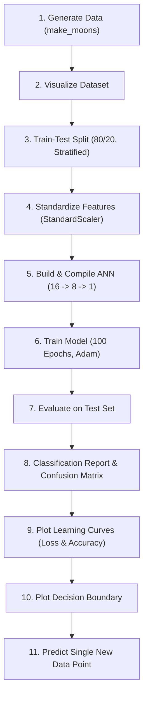

# Artificial Neural Network (ANN) - Binary Classification (`make_moons`)

An end-to-end deep learning project implementing a feedforward Artificial Neural Network (ANN) using **TensorFlow/Keras** and **scikit-learn** to solve the classic non-linear binary classification problem on the `make_moons` dataset.

---

## 📌 Table of Contents
- [Overview](#overview)
- [Key Features](#key-features)
- [Model Architecture](#model-architecture)
- [Workflow Pipeline](#workflow-pipeline)
- [Project Structure](#project-structure)
- [Prerequisites & Installation](#prerequisites--installation)
- [Running the Project](#running-the-project)
- [Visualizations & Expected Outputs](#visualizations--expected-outputs)
- [Author](#author)

---

## 📖 Overview

The `make_moons` dataset generates two interleaving half-circles, creating a non-linearly separable classification challenge that simple linear classifiers cannot solve.

This project demonstrates how a multi-layer perceptron (ANN) with non-linear activation functions (`ReLU`) maps non-linear feature spaces, achieves high classification accuracy, and cleanly delineates the decision boundary between the two classes.

---

## ✨ Key Features

- **Synthetic Dataset Generation**: Creates 1,000 samples with controlled Gaussian noise (`noise=0.2`) using `sklearn.datasets.make_moons`.
- **Feature Scaling**: Implements standardization (`StandardScaler`) to normalize feature distributions and accelerate gradient descent convergence.
- **Deep Neural Network**: Configures a 3-layer sequential feedforward neural network in TensorFlow/Keras.
- **Comprehensive Evaluation**: Measures test loss, test accuracy, confusion matrix, and detailed precision/recall/F1 metrics.
- **Rich Visual Diagnostics**:
  - Raw dataset scatter plot
  - Training vs. Validation Loss curves
  - Training vs. Validation Accuracy curves
  - 2D Decision Boundary contour mapping
- **Sample Inference**: Provides a test pipeline to predict probabilities and classes for unseen data points.

---

## 🧠 Model Architecture

The neural network is built with Keras `Sequential` API:

| Layer | Type | Units / Neurons | Activation | Output Shape | Notes |
|---|---|---|---|---|---|
| **Input** | Feature Vector | 2 | — | `(None, 2)` | Standardized 2D coordinates |
| **Hidden Layer 1** | Dense | 16 | `ReLU` | `(None, 16)` | Feature extraction |
| **Hidden Layer 2** | Dense | 8 | `ReLU` | `(None, 8)` | Non-linear representation |
| **Output Layer** | Dense | 1 | `Sigmoid` | `(None, 1)` | Probability output: $P(y=1 \mid x)$ |

### Compilation Configuration:
- **Optimizer**: Adam (`optimizer="adam"`)
- **Loss Function**: Binary Cross-Entropy (`loss="binary_crossentropy"`)
- **Metric**: Accuracy (`metrics=["accuracy"]`)
- **Training Hyperparameters**:
  - Epochs: `100`
  - Batch Size: `32`
  - Validation Split: `0.2` (20% of training data)

---

## 🔄 Workflow Pipeline



---

## 📁 Project Structure

```text
.
├── main.py        # Complete execution script (data prep, training, eval, plots)
└── README.md      # Project documentation
```

---

## 🛠️ Prerequisites & Installation

### 1. Requirements
- Python 3.8 or higher
- pip package manager

### 2. Clone the Repository
```bash
git clone https://github.com/ASHBA2801/ANN-AI-COE-Project.git
cd ANN-AI-COE-Project
```

### 3. (Recommended) Set up a Virtual Environment
```bash
# On Linux/macOS:
python3 -m venv venv
source venv/bin/activate

# On Windows:
python -m venv venv
venv\Scripts\activate
```

### 4. Install Dependencies
```bash
pip install numpy matplotlib scikit-learn tensorflow
```

---

## 🚀 Running the Project

Run the main pipeline:

```bash
python main.py
```

### Script Execution Sequence:
1. **Plots Data**: Displays the raw scatter plot of the two moons. Close the window to proceed.
2. **Trains Model**: Trains for 100 epochs, displaying progress and loss/accuracy per epoch.
3. **Prints Evaluation Metrics**:
   - Test Loss & Test Accuracy
   - Full Classification Report (Precision, Recall, F1-Score)
   - Confusion Matrix
4. **Plots Curves**: Displays the training & validation accuracy and loss graphs.
5. **Plots Decision Boundary**: Shows the non-linear decision boundary learned by the network.
6. **Inference**: Prints the predicted class and probability for test point `[0.5, 0.2]`.

---

## 📊 Visualizations & Expected Outputs

### Classification Report & Metrics (Sample Output):
```text
Test Loss: ~0.15 - 0.25
Test Accuracy: ~0.92 - 0.98

Classification Report:
              precision    recall  f1-score   support

           0       0.96      0.94      0.95       100
           1       0.94      0.96      0.95       100

    accuracy                           0.95       200
   macro avg       0.95      0.95      0.95       200
weighted avg       0.95      0.95      0.95       200
```

### Single Point Inference:
```text
New Data Point: [[0.5 0.2]]
Probability of Class 1: 0.91...
Predicted Class: 1
```

---

## 👤 Author

- **GitHub**: [@ASHBA2801](https://github.com/ASHBA2801)
- **Repository**: [ANN-AI-COE-Project](https://github.com/ASHBA2801/ANN-AI-COE-Project)
